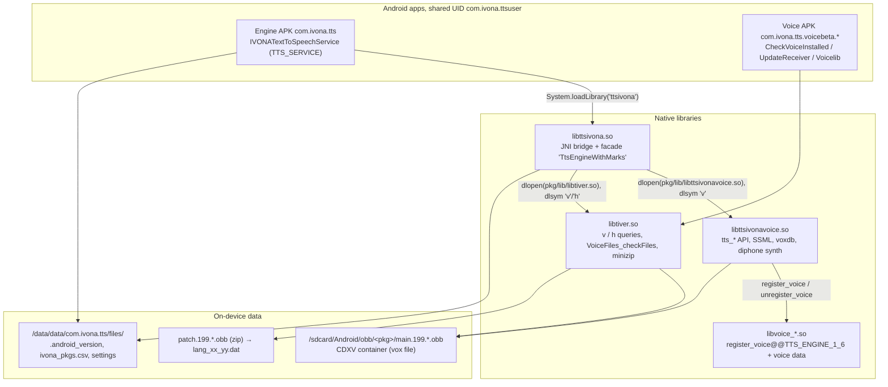

# IVONA 2 Text-To-Speech — reverse-engineering brief for reimplementation

Target archive: `/home/asdf/Downloads/IVONA 2-20210318T191653Z-001.zip`
Working dir for everything below: `/home/asdf/Downloads/ivona_re/`
All statements are backed by files in this directory; addresses are Ghidra addresses
(image base `0x10000`, so *Ghidra addr = ELF vaddr + 0x10000*, thumb bit stripped).

---

**Start here for the current state:** `REPLICATION_STATUS.md` — per-layer verdict with the
verification evidence and the single remaining open item. Build order: `REPLICATION_HANDBOOK.md`.

## 1. What is in the box

| Artifact | Size | Notes |
|---|---|---|
| `IVONA Text-to-Speech HQ 1.6.55.617.apk` | 512 692 B | engine app, pkg `com.ivona.tts`, versionCode **617**, minSdk 4 / target 14 / maxSdk 22, sha256 `3b82476944d975f2fde4a34170535df2bcce836fb8c47da795bd74e69504372d` |
| `com.ivona.tts.voicebeta.eng.usa.kendra.apk` | 2 470 302 B | voice pack, versionCode **422** (1.6.23.422), sha256 `31a3f7d095a3aeb41d4739bc722cf2dec8b37644c23dd37b1ee6afd420062b7d` |
| `com.ivona.tts.voicebeta.eng.gbr.amy.apk` | 2 466 530 B | voice pack, versionCode **422**, sha256 `aab581223b15baddfc23ab8fae75380bf19b8adaf0261e7561461103e1380c43` |
| `main.199.<voicepkg>.obb` | 152 219 597 B (Kendra) / 149 905 560 B (Amy) | **not a zip** — starts with ASCII `CDXV vox_en_us_kendra…` (proprietary container) |
| `patch.199.<voicepkg>.obb` | 74 861 B (both) | ordinary ZIP holding one entry `lang_en_us.dat` / `lang_en_gb.dat` |
| store `manifest.json` ×2 | 1 141 / 1 108 B | XAPK metadata: package, versionCode, expansion paths, `total_size` |

* All three APKs are signed by the **same** certificate, which is what makes the
  `android:sharedUserId="com.ivona.ttsuser"` work:
  `CN=IVONA Software Sp. z o.o., O=IVONA Software Sp. z o.o., L=Gdynia, ST=Pomorskie, C=PL`,
  sha1 `64:7A:B1:77:5F:DF:0C:8E:EA:BA:A3:98:4A:77:91:EA:B9:35:E4:97` (extracts in `out/certs/`).
* Engine APK native code: one lib, `lib/armeabi/libttsivona.so` (472 444 B, ARM32/Thumb, stripped,
  sha256 `a7cb15fe22b09dd99d6b5ce7ce363faff58d7e841f28b9b5907bde861bb36476`).
* Each voice APK ships three libs (extracted to `out/libs/{kendra,amy}/`):

| lib | size | identical across voices? | role |
|---|---|---|---|
| `libttsivonavoice.so` | 1 637 476 B | yes (md5 `2274b82e…`) | **the TTS core**: SSML, phonetics, diphone/voxdb, `tts_*` C API |
| `libtiver.so` | 124 164 B | yes (md5 `b381ee3b…`) | voice-package helper: OBB/patch validation, zip reading, `v`/`h` queries |
| `libvoice_<locale>_<name>.so` | ~3.0 MB | **no** (per voice) | voice plugin: `register_voice@@TTS_ENGINE_1_6`, `.rodata` = packed lexicons + letter-to-sound FSMs + tables (the acoustic data is the external OBB vox file) |

There is no installer: on Android the "installer" is the APK + Google Play expansion (OBB) flow.
Decompiled trees: `out/jadx_tts*/` (engine), `out/jadx_kendra/`, `out/jadx_amy/`.
Ghidra dumps: `out/ghidra_dump/{decompiled.c, libttsivonavoice.c, libtiver.c, libvoice_kendra.c}`.

---

## 2. System architecture



Call chain for one utterance:

1. Android binds `android.intent.action.TTS_SERVICE` → `com.ivona.ttslib.ics.IVONATextToSpeechService`.
2. `speak(SynthesisRequest, SynthesisCallback)` (Java) → `callback.start(sampleRate, ENCODING_PCM_16BIT, 1)`,
   `setProperty("rate", …)`, `setProperty("pitch", …)` → native `synthesizeText(text, buf, marks, markMask)`.
3. JNI `Java_…_ICS_synthesizeText__…List…I` (Ghidra `0002019c`) builds a callback struct holding
   `GetMethodID(audioAvailableClbk,"(II)I")`, converts the text, optionally enables marks, then calls
   facade vtable `+0x30` (`FUN_0001c8f0`, Ghidra `0001c8f0`).
4. The facade pulls PCM from the voice engine in chunks into the Java byte[] and invokes the Java
   callback → `SynthesisCallback.audioAvailable(bytes, 0, len)` (optionally with `List<SpeechMark>`),
   finishing with `callback.done()`.

---

## 3. Android layer (summary; full detail in `report_engine_app.md`)

Manifest-verified components of `com.ivona.tts` (`out/jadx_tts_res/resources/AndroidManifest.xml`):

| Component | Intent / role |
|---|---|
| `com.ivona.ttslib.ics.IVONATextToSpeechService` | `android.intent.action.TTS_SERVICE` + `<meta-data android.speech.tts → @xml/tts_engine>`; `tts_engine.xml` sets `settingsActivity=com.ivona.tts.EngineSettings` |
| `com.ivona.ttslib.DownloadVoiceData` | `android.speech.tts.engine.INSTALL_TTS_DATA` |
| `com.ivona.ttslib.CheckVoiceData` | `android.speech.tts.engine.CHECK_TTS_DATA` (also writes `/data/data/com.ivona.tts/files/.android_version` = `Build.VERSION.SDK_INT`) |
| `com.ivona.ttslib.GetSampleText` | `android.speech.tts.engine.GET_SAMPLE_TEXT` |
| `com.ivona.tts.Ivona` | `android.intent.action.START_TTS_ENGINE` with categories `tts_engine.IVONA`, `tts_lang.eng`, `tts_lang.eng.USA`, `tts_lang.eng.GBR`, `tts_lang.pol`, `tts_lang.deu`, `tts_lang.fra`, `tts_lang.spa`, `tts_lang.spa.ESP`, `tts_lang.spa.USA`, `tts_lang.ron` |
| `com.ivona.ttslib.engine.TTSServiceActivation`, `CustomSettingsService` | helper services |
| `ActivityReceiver`, `PackageMonitorReceiver`, `HeadsetPlugReceiver` | lifecycle / package-change / headset |

Voice packs advertise themselves through activities/receivers and `tts_lang.*` categories, and are
enumerated by the engine with `PackageManager.getPackagesForUid` on the shared UID plus the native
`IvonaPackagesInfo.getVoicesApiVersion(String[])` (Ghidra `000236fc`), which dlopens
`<pkgdir>/lib/libtiver.so`, calls its `v` and `h` symbols and formats
`"apiVer;fstate;displayName;stamp;dataLocation"` per package (5 fields; Java consumes 4) —
gates on the `v()` info struct `struct[0] > 0x13 && struct[3] > 0x2f && struct[1] < 3`
(`{20, 2, "20130201_150739", 48, accessor-fn}`). Results are cached in
`/data/data/com.ivona.tts/files/ivona_pkgs.csv` (7 `;`-columns).

Java ↔ native contract (verified in `out/jadx_tts/sources/com/ivona/ttslib/ics/`):

| Java native | Purpose |
|---|---|
| `setEnvRuntime(String appParent, String externalStorage)` | stores the two base dirs used by every native path: `"/data/data/"` and `"/sdcard/"` (Ghidra `DAT_00084308`, `DAT_0008430c`) |
| `create()` / `destroy()` | instantiate/tear down the facade singleton (`DAT_000842c4`) |
| `onLoadLanguage(lang, country, variant)` | calls facade `+0x1c`, returns Android-style codes (negative = unavailable) |
| `onGetLanguage()` | facade `+0x20` → `String[3] {language, country, variant}` (variant always `""`) |
| `getSampleRate()` | facade `+0x24`; defaults to **16000** when no voice loaded (`FUN_0001c544`), else the voice rate (Kendra OBB header says **22050**) |
| `setContrast(int)` | facade contrast hook (`FUN_0001cf1c`) |
| `stop()` | facade `+0x10` |
| `synthesizeText(text, byte[] buf, List marks, int mask)` | main entry (above) |
| `setProperty(k, v)` | facade `+0x28` = `FUN_0001c2c4` |
| `getVersion()` | **returns `{"IVONA_DIR", "0ff4b2c4fa69f57df9ccbe30ee665658f7b1ee49"}`** — declared but never called by app code |
| `IvonaPackagesInfo.isoemn()` | returns constant `0` |
| `ConfigXMLDataSet.getSettingsCfg()/getPackagesCfg()` | parse `/etc/ivona/ivona_config.xml` (see §5) |

`NativeIVONAEngineICS.speak()` (Java, full body read):

```java
callback.start(getSampleRate(), 2 /*PCM_16BIT*/, 1 /*mono*/);
maxBufferSize = callback.getMaxBufferSize();           // byte[] grown to that
setProperty("rate",  request.getSpeechRate());
setProperty("pitch", request.getPitch());
int marksMask = parseInt(params["com.ivona.tts.oem.GENERATE_MARKS"]);   // 0 if absent
int contrast   = parseInt(params["com.ivona.tts.oem.SET_CONTRAST"]);    // 1 if absent
if (marksMask > 0) synthesizeText(text, audioBuffer, marksList, marksMask);
else              synthesizeText(text, audioBuffer);
callback.done();
```

`audioAvailableClbk(int len, int status)` → `status == 0` means *synth done* (returns 1),
otherwise `callback.audioAvailable(audioBuffer, 0, len)`, or the reflective 4-arg
`audioAvailable(byte[], int, int, List<SpeechMark>)` when marks were requested.

Property keys accepted by the native facade (`FUN_0001c2c4`): **`rate`**, **`volume`**, **`pitch`**
— integer percent, `<= 0` is reset to `100`; unknown key → return `-4`, null value → `-3`.
In `synthesizeText` they are applied as `dur_stretch = 100/rate` and `pitch_stretch = 100/pitch`.

Speech marks: native emits 20-byte records
`{int type; char* name; int startTextOffset; int endTextOffset; int sampleOffset}`
(types 0–4), which `FUN_0001fac0` converts into `android.speech.tts.SpeechMark` objects
(`type`, `name`, `startTextOffset`, `endTextOffset`, `sampleOffset`) and appends to the Java
`ArrayList` that was passed in. The requested-type bitmask is the 4th JNI argument.

Side channel: the native lib opens an `AF_UNIX/SOCK_STREAM` client (`FUN_0001f6e0` / `FUN_0001f82c`,
message built by `FUN_0001f5bc`) to a Java `LocalServerSocket` named `com.ivona.tts.log`
(or `com.ivona.tts.<uid>.log` when `android_version >= 14`) — i.e. `com.ivona.ttslib.engine.d.b()`
/ `TTSEngineListener` (`com.ivona.ttslib.engine.f`). Verified protocol
(`report_engine_app.md` §4.3/§9.3/§9.4):

| direction | bytes | meaning |
|---|---|---|
| server → client on accept | `0xBB` | hello |
| client → server | `"exists"` (6 ASCII bytes) | health probe (also sent by the engine itself) |
| server → client | `0x38` | probe OK |
| client → server | `"close"` | stop listener |
| client → server | XOR-encrypted message (64-byte key literal + trailing 48 bytes as key material) | `int32 type, int32 status, byte==2 ? NUL-terminated UTF-8 string : …` |
| server → client | `0x0B2F14` (written as one byte `0x34`) | ack after every non-probe request |

Status strings recognised: `"Voice library version mismatch"` → restart-engine toast,
`"Voice not allowed by the certificate"` → activation-error toast. No code inside these three APKs
ever *sends* an encrypted message — the peer is external `[INFERENCE]`.

---

## 4. Native layer

### 4.1 `libttsivona.so` (the bridge)

Exported JNI symbols (from `.dynsym`): `Java_com_ivona_ttslib_ics_NativeIVONAEngine_{create,destroy,stop,setContrast,onLoadLanguage,getSampleRate,getVersion,onGetLanguage,setEnvRuntime}`,
`Java_com_ivona_ttslib_ics_NativeIVONAEngineICS_{synthesizeText×2,setProperty}`,
`Java_com_ivona_ttslib_config_ConfigXMLDataSet_{getSettingsCfg,getPackagesCfg}`,
`Java_com_ivona_ttslib_packages_IvonaPackagesInfo_{isoemn,getVoicesApiVersion}`,
plus C `getTtsEngine`.

Facade object (`DAT_000842c4`, class name in errors: **`TtsEngineWithMarks`**), vtable read out of
`.data.rel.ro` at file offset `0x70668`:

| offset | target | meaning |
|---|---|---|
| `+0x00/+0x04` | `FUN_0001c194` / `FUN_0001c1a4` | dtor / deleting dtor |
| `+0x08` | `FUN_0001c59c` | last-error string (`"could not create streamer: %s"` path) |
| `+0x0c` | `FUN_0001c504` | release/destroy instance |
| `+0x10` | `FUN_0001c4ec` | `stop()` |
| `+0x14` | `FUN_0001db6c` | (untraced) |
| `+0x18` | `FUN_0001c190` | (untraced) |
| `+0x1c` | `FUN_0001e90c` | `loadLanguage(lang, country, variant)` |
| `+0x20` | `FUN_0001c394` | `getLanguage()` → reads `DAT_000840ac` `{+0xc lang, +0x10 country}`, variant `""` |
| `+0x24` | `FUN_0001c544` | `getSampleRate()` (default 16000) |
| `+0x28` | `FUN_0001c2c4` | `setProperty` (`rate`/`volume`/`pitch`) |
| `+0x2c` | `FUN_0001c1d4` | (untraced; contrast-related) |
| `+0x30` | `FUN_0001c8f0` | `synthesizeText(text, short* buf, bytes, marksEnabled)` |

Bootstrap: `create()` → `FUN_0001cf48()` (singleton) → `FUN_0001cec0(handle, 0x1fac1, 0)`
where `0x1fac1` is the Thumb address of the audio callback `FUN_0001fac0`.

Loading the actual engine (`FUN_000234c0`, Ghidra `000234c0`, the "voice junction" loader; its
`_INIT_1` at `00023660` zeroes the globals):

1. base dirs from `setEnvRuntime`: `DAT_00084308 = "/data/data/"`, `DAT_0008430c = "/sdcard/"`.
2. If the voice-dir string `DAT_000842d8` is empty, `FUN_000234c0` calls `FUN_0002434c(1)` to get the
   list of discovered voice packages (`std::deque<boost::shared_ptr<CVoiceDataSimple>>`) and copies
   field `+0x4` of the **first** entry (the selected voice's package name) into `DAT_000842d8`
   (`DAT_000842d4` gets another string from `FUN_00023ecc`). Then:
   `path = "/data/data/" + DAT_000842d8 + "/lib/libttsivonavoice.so"` →
   `dlopen(path, RTLD_NOW)` → `dlsym("v")` → call → engine handle `DAT_000842cc`.
   Failures log `Cannot open library: %s` / `Cannot use voice library`.
3. `FUN_00023284` decodes the embedded license (§4.4) and calls `engine->vtable+0x0c(certText)`;
   the returned instance is `DAT_000842c8` ("TTS instance"). Errors:
   `could not prepare data for TTS instance`, `could not init TTS instance: %s`.
4. `dlopen("<dir>/lib/libtiver.so")` is used for package queries and vox-path resolution;
   `tts_voice` path helpers build strings from `ivona/`, `Android/obb/`, `/lib/`, `/`,
   with failure text `An error occured on determinig path to vox file.`.

Config: `FUN_00022ec8` loads **`/etc/ivona/ivona_config.xml`** only (there is no copy in the APK —
`unzip -l` shows no `assets/`); on `fopen` failure the config object stays empty and
`ConfigXMLDataSet.getSettingsCfg()` returns `null`, so all runtime settings fall back to Java defaults.
Document shape when present: root element `ivona_config` with children
`global/{voice_data, voice_lib, lex_dir, ca}` and `packages/package@name`
(keys observed as string literals at file offsets `0x6ce9e` `voice_data`, `0x6cea9` `voice_lib`,
`0x6ceb3` `lex_dir`, `0x6cebb` `ca`; also `global` `0x6ce8e`, `packages` `0x6ce95`,
`package` `0x6ce5d`, `ivona_config` `0x6ce81`).

Small per-key files: `FUN_0001c424(key, buf, n)` reads
`/data/data/com.ivona.tts/files/.<key>` (format `"%s.%s"`); the only writer found is
`CheckVoiceData.a(".android_version", SDK_INT)`.

### 4.2 `libttsivonavoice.so` — the core

250 dynamic symbols (mostly libstdc++ runtime); the real API is the 30 `tts_*` functions plus the
factory `v` and `CIvonaTTS::CIvonaTTS()` — the same set, laid out as the ABI vtable that `v()`
returns (table at dump `000284cc`; offsets verified against the bridge's call sites and against
the exports — `report_engine_api.md` §1): the static `CIvonaTTS` function-pointer table (dump `000284cc`), which is the
ABI a reimplementation must match — offsets verified against both call sites in the bridge and
the `tts_*` exports (`report_engine_api.md` §1):

| + | member | | + | member |
|---|---|---|---|---|
| `0x00` | `tts_vendor_tag` | | `0x3c…0x4c` | `tts_dict_{insert,remove,save,load,…}` |
| `0x04` | `tts_errno` | | `0x50/0x54` | `tts_pls_load` / `tts_pls_unload` |
| `0x08` | `tts_errmsg` | | `0x58` | `tts_streamer_start` |
| `0x0c` | `tts_init` (takes the decoded certificate) | | `0x5c` | `tts_streamer_stop` |
| `0x10` | `tts_create` | | `0x60` | `tts_streamer_jump` |
| `0x14` | `tts_load_certificate_file` | | `0x64` | `tts_streamer_add_voice` |
| `0x18` | `tts_load_certificate` | | `0x68` | `tts_streamer_synth0` |
| `0x1c` | `tts_destroy` | | `0x6c` | `tts_streamer_synth` |
| `0x20/0x24` | `tts_certificate_get` / `_single` | | `0x70` | `tts_wave_delete` |
| `0x28` | `tts_load_voice` | | `0x74` | `tts_get_input_warning` |
| `0x2c` | `tts_unload_voice` | | | |
| `0x30` | `tts_voice_param` | | | |
| `0x34` | `tts_voice_sample_rate` | | | |

Handles: engine (magic `0x3e1b8f65`, 6 words: certs / current-ctx / voice-list / mutex / registry),
certificate wrapper (magic `0x730366b1` + parsed fields: expiry `int64`, serial, priority,
`float` thread-speed and num-threads (`-1` = UNLIMITED), group, Voices constraint, SSML flag),
voice handle (0x1c B), streamer `{voice, core 0x44}`, wave (0x18) + marks (0x14 stride).
`tts_errno` codes 0…10 map to static strings (`report_engine_api.md`).

Also bundled in this lib: a full SSML 1.1 parser (W3C `2001/10/synthesis` plus IVONA's
`http://www.ivona.com/2009/12/ssml`), PLS lexicons (W3C `2005/01/pronunciation-lexicon`), PCRE,
expat, an HTTP client with UA `ivona/1.6.23 (IVONA Text-To-Speech; +http://www.ivona.com)`
(`file://` and `http://` only), and the voice-database layer — visible as the strings
`voxdb`, `vox_lexicon`, `diphonedb`, `diphone_graph_func`, `diphoneset_num`, `phoneset`,
`resample_wave`, and the errors `**Error: voxdb read: \`%s'`, `The vox file does not exist`,
`Invalid voice library data`, `Voice library version mismatch: got %s, required %s`.
`CDXV` occurs here and in `libvoice_*.so` only as the literal magic compared against the
`main.*.obb` header (§4.5). Full detail: `report_engine_api.md`, `report_engine_synth.md`.

### 4.3 `libtiver.so` — voice-package helper

Exports: `v`, `h`, `Java_com_ivona_tts_voicelib_VoiceFiles_checkFiles`, plus a bundled minizip
(`unz*`) and zlib (`inflate`, `crc32`). Full analysis in `report_libtiver.md`; the essentials:

* `v()` (info struct at ELF `0x1f004`) returns a 5-word info struct
  `{20, 2, "20130201_150739", 48, entry_by_index}`; `struct[4]` is a Thumb function
  `entry_by_index(i) = table + i*48` for `i ≤ 43` (active when `struct[1] == 2`).
* `h()` returns `int` (Ghidra typed it `void`) and tail-calls `FUN_000169b8(pkg, base, flag=0)`;
  `checkFiles` runs the same with `flag=1`.
* 42-row hardcoded package table at ELF `0x1d538` (48-byte rows): package name → expected
  `main.<N>.<pkg>.obb` file name **and exact byte size** (size gate compares `st_size`
  low/high halves against field `[9]`; Kendra 152 219 597 / Amy 149 905 560 verified against the
  real files). `N ∈ {183, 199, 422}` per voice; the **patch** version is the C literal `199`
  (`patch.199.<pkg>.obb`), independent of the table.
* Probe order for data roots: `<sdcard>/ivona/` then `<sdcard>/Android/obb/<pkg>/`
  (path grammar `<base><pkg>/main.<N>.<pkg>.obb`).
* Patch handling: `unzOpen` → per-entry extraction to the OBB dir, 8 KiB copy loop, CRC ignored;
  the "already extracted" test compares `st_size` against the **zip entry-name length**
  (`unz_file_info.size_filename`), so entries are effectively re-extracted on every call
  (documented skip-predicate bug). Unknown package names fall through to an all-zero terminator
  row and dereference a NULL obb-name pointer (UB).
* Return codes: `0` / `1` / `-1` / `-2` (exact contract in the report).

Decoded table + row data: `scripts/table_full.json`.

### 4.4 Embedded license (decoded)

`FUN_00023284` de-XORs 1798 bytes from `.rodata`
(`KEY=0x6d070`, `D=0x6d079`, `D2=0x6d07d`;
`len = Σ_{i<4} ((d[KEY+(i+5)%9]^d[KEY+i%9]^d[D+i])&0xff)<<(8i)`;
`out[i] = d[D2+i]^d[KEY+(i+4)%9]`) and feeds the text to the engine. Decoded file:
`out/certs/ivona_certificate_decoded.txt`. Content:

```
Product: IVONA
Certificate-ID: a1169787
Num-threads: UNLIMITED / Thread-speed: UNLIMITED
Expiration-date: NEVER / Voices: ALL / Extension-SSML: TRUE
-----BEGIN SIGNATURE-----   (14 lines, 1040 hex chars = 520 bytes → RSA-4096) -----END SIGNATURE-----
```

Engine-side certificate strings: `The certificate does not allow for SSML input`,
`Invalid certificate of authenticity`, `The certificate of authenticity has expired`,
`Too many certificates concurrently loaded in the system`, path token `/IVONA-e3a8a7e2d4d4fca3`.

### 4.5 `libvoice_*.so` — voice data plugin

Two exported functions, both version-tagged: `register_voice@@TTS_ENGINE_1_6` (`0x168a0`, 56 B)
and `unregister_voice@@TTS_ENGINE_1_6` (`0x1689c`, 4 B). `TTS_ENGINE_1_6` is an ABS dynsym, but
the engine calls plain `dlsym`, so the effective version gate is
`strcmp(eng_version, "1.6.23")`.

* `void *register_voice(const char *vox_path)` → 12-byte object `{listA@0, listB@4, 0@8}`;
  the vox path flows unmodified into `FUN_00030020`. `unregister_voice(void*)` frees both lists
  and the object.
* List node = 12 B `{key*, variant*, next*}`; variant = 8 B `{u16 tag, pad, payload*}`;
  known tags `0x1F` = diphonedb, `0x1B` = lexicon. Type-name run at `.rodata 0x56A0C…0x56B78`,
  `{name,code}` registry at `.data.rel.ro 0x2EFB90…0x2EFCFC`.
* ELF layout (Kendra): `.text` 0x40124 B @ `0x1688c`, `.rodata` **0x28d3d8 B @ `0x569b0`**
  (file offset == VMA for every allocated section), `.data.rel.ro` 0xc040 B.
* `.rodata` split (9 regions, reproduced by `scripts/06_rodata_map.py`): shared strings
  `0x569B0…0x60428`; word/phoneme tables to `0x64BFC`; **en_US packed lexicon**
  `0x64BFC…0x1CBA5C` (0x166E60 B, header `{count = 0x1EE0C = 126 476, len}`; 126 462 entries
  decoded — `0xFF`-delimited, key = NUL-terminated u8 indices into a 256-slot string pool,
  leading flag char skipped by `strcmp`, variable tail = pronunciation `[INFERENCE]`);
  en_US letter-to-sound FSM at `0x1CC088` + 27-u32 letter table `0x1EDA48`;
  en_GB lexicon `0x1F2CBC…0x2AE0BC` (0xBB400 B, count `0xF126`) + FSM `0x2AE434` + letter table
  `0x2CEC48`; tail numeric tables `0x2D0000…0x2E3D88`.
* LTS FSM record = 6 B `{u8 input_pos, u8 ch, u16 next_if, u16 next_else}`, terminator `0xFF`.
* **No `CDXV` container is embedded in the plugin** — its 3 occurrences are ARM literal-pool
  words of the constant `0x56584443` (`FUN_00027bd0`, `FUN_00027f90`, `FUN_00028008`); the
  acoustic data lives in the external vox file (OBB). The plugin validates the vox header:
  magic, `char[32]` name, `u32` sample rate `+0x24`, `u32` format id `+0x28`
  (accepted values **2, 8, 12, 14**), `u32` checksum `+0x2C`; path built as
  `<dir>/<name>/<checksum>/<name>22v`.
* Kendra vs Amy: `.text` same size/layout with 3 894 differing bytes (1.48 %, all pc-relative
  constants and table sizes, no run > 3 B; 386/495 functions byte-identical), `.rodata` +0x960 B
  in Kendra with content shifted 0x2464; per-voice literals
  `vox_en_us_kendra` / 1333557784 / en-US / Kendra / 36 versus
  `vox_en_gb_amy` / 1334671314 / en-GB / Amy / 37; both binaries ship both en_US and en_GB
  datasets and select at runtime.

New-plugin recipe: `report_libvoice.md` §4; open questions §5.

---

## 5. Data files on device

| Path | Format |
|---|---|
| `/sdcard/Android/obb/<voicepkg>/main.199.<voicepkg>.obb` | `CDXV` container — §5.1 |
| `/sdcard/Android/obb/<voicepkg>/patch.199.<voicepkg>.obb` | ZIP holding one `lang_*.dat` — §5.2 |
| `/data/data/com.ivona.tts/files/ivona_pkgs.csv` | engine-side cache of discovered voice packages (written by `IvonaPackagesInfo`) |
| `/data/data/com.ivona.tts/files/.android_version` | decimal `Build.VERSION.SDK_INT`, read natively as key `android_version` |
| `/data/data/com.ivona.tts/files/<settings file>` | read/written by `com.ivona.tts.EngineSettings` (`openFileInput/Output`) |
| `/etc/ivona/ivona_config.xml` | optional, usually absent (see §4.1) |
| `<voicepkg>/lib/*.so` | the three native libs; located via `getApplicationInfo().dataDir` parent (`/data/data/`) |

Runtime env set by Java: `setEnvRuntime(parent(dataDir)+"/", externalStorage+"/")`
= `("/data/data/", "/sdcard/")`.

### 5.1 `main.199.*.obb` — the `CDXV` container (byte level, `report_obb_format.md`)

```
0x00000000  header, 0x68 (104) bytes
            +0x00 char[4]  "CDXV"
            +0x04 char[32] voice id, NUL-padded  ("vox_en_us_kendra", "vox_en_gb_amy")
            +0x24 u32      sample rate (22050 in both files)
            +0x28 u32      format id = 14   (engine dispatches on it)
            +0x2C u32      checksum 1333557784 / 1334671314  (also parses as a 2012 unix time)
            +0x30..0x64    7 × (u32 offset, u32 length) section descriptors:
                           @0x30 index, @0x38 payload-region offset (len 0), @0x40..0x64 sections A–E
0x00000068  index: N × 8 B of (u32 file_offset, u32 length); N = len/8 = 426 991 (Kendra) /
            404 847 (Amy); records tile [first_offset … EOF] contiguously, unaligned, uncompressed;
            8 496 / 8 164 entries are explicit (0,0) null slots
0x00341FE0  section A  diphone table: char[12] name + u32 start + u32 count (20 B records,
            chain-contiguous; sum(count) = len(B)/4; 1 601 / 1 772 diphones)
0x00349CF8  section B  u32 array, exactly a permutation of the non-null index-entry numbers,
            sorted per diphonе slice
0x004E27F8  section C  36 B per unit, positional over the index:
            u16 duration-ish (engine divides by 1000.0f), 5 phone-id bytes (2..6, verified
            against section E), nibble-packed run byte 7 = (remaining<<4)|(index+1),
            bytes 9/15 constant, 16 B spectral block (16..31), u32 offset into D at 32
            (monotone; last + len(D-entry) == len(D))
0x0138B598  section D  variable byte blocks (17–1020 B), chained by u16 relative offsets,
            roots shared by runs of 1–7 consecutive units; contains phoneme ids + nibble params
0x0182E198  section E  phoneme names, 32 B records: 58 entries (Kendra) / 62 (Amy, +{eax,iax,o,uax});
            id = record index
…           "gap" payload region [0x182E8D8 … 0x7FABF03) K / [0x17072A0 … 0x7C8F6C4) A
            = 108.5 / 106.5 MB at entropy ~8.0 — every index record's (offset,length) window
            lies inside it, overlapping ~3.4×; codec not identified [see report §14]
```

Section letters differ between reports: `report_obb_format.md` names them A–E after the five
header pairs at `+0x40…+0x64`, `report_engine_synth.md` names all seven pairs A–G starting with
the `+0x30` index pair. Same bytes: obb-A = synth-C (diphoneset name table, 1601×20 B),
obb-B = synth-D (u32 diphone index, 418 495×4 B), obb-C = synth-E (36 B records, 426 991 = index
count), obb-D = synth-F (byte pool), obb-E = synth-G (phoneme names, 58×32 B = 1 856 B),
obb-"index" = synth-A (`{offset,size}` directory at `0x68`), and synth-B is the payload-region
pair (`+0x38`, size 0).

Every non-null index entry is a fixed "unit record": `u16 N; u16 ramp[N]; u16 Y; u32 gap_off;
u32 gap_len` with `gap_len == 2N + 12` validated on all records, `ramp` monotone and `ramp[N−1]` =
the unit's total sample count, `Y` = codec warm-up samples to discard (`Y ∈ [2063,4799]` Kendra /
`[294,4799]` Amy).

**The gap payload is decoded** (`report_gap_codec.md`, `scripts/decode_unit.py`): it is one
continuous stream of `u16le len; u8 payload[len]` packets (every unit's `gap_off` lands on a packet
boundary — 15 015/15 015 checked). Packet payloads carry a reversible **self-keyed XOR**
obfuscation:

```
m   = n & ~3
key = u32le(header checksum @ +0x2C) ‖ (payload[m:n] zero-padded to 4)
payload[i] ^= key[i % 8]      for i < m        # no secret material involved
```

The de-obfuscated packets feed a **proprietary fixed-point MDCT + Huffman transform codec**
(static codebooks in `.rodata`, Q31 twiddles, 2 400 samples per packet, native 24 kHz, inter-frame
stateful — hence overlapping windows and the `Y` skip). Container type `header+0x28 = 14` selects
`FUN_0005f49c` → `LAB_00067db8` → `FUN_00067a14`; the other voice formats use `FUN_000685c4`
(type `0xc`). Verified: decoded sample count == `ramp[N−1]` for every tested record (both voices),
engine path == the reference driver bit-exactly, and the output is voiced speech (record 3:
F0 ≈ 134–138 Hz, harmonic stack + formants; WAVs in `out/gap/`).

### 5.2 `patch.199.*.obb`

Ordinary ZIP containing exactly one entry `lang_en_us.dat` / `lang_en_gb.dat` (74 668 B).
The payload is an **`ISEF` lexicon container — now fully solved** (`report_isef.md`,
`scripts/isef_decrypt.py`):

```
0x00 "ISEF" | 0x04 u32be 1 (version) | 0x08 u32be build id 0x50992bcc
0x0C 512 B  RSA-4096 block, recovered with the PUBLIC key (n @ file 0x14bd78, e = 65537 @ 0x14bf78),
            PKCS#1 v1.5 type-1 padding -> 64-B blob = AES-256 key(32) || IV(16) [+16 unused]
0x20C ...   AES-256-CBC (PKCS#7) ciphertext of the section table
            section = char[16] name | u32be size | data[size]
```

Verified decryption (mine): `lang_en_us.dat` → 4 sections `prm_lexicon` 72 722 B (660 PCRE
rewrite rules), `prm_pre_lexicon` 624 B, `prm_post_lexicon` 666 B, `prm_lex_list` 45 B; en_GB has the
same shape. Plaintexts: `out/obb/*.dec.bin`. `libtiver.so` opens the patch with `unzOpen` and writes
the entry next to the OBB; the engine then consumes it via `tts_pls_load`/`tts_dict_load`.
No dictionary/word list exists anywhere in `main.obb`; voice metadata
(`language_code`, `voice_name`, `gender`, `viterbi_beam`, `eng_version=1.6.23`, …) lives in
`libvoice_*.so`.

---

## 6. Synthesis pipeline (`report_engine_synth.md`, 1 376 lines)

1. **Input admission** `FUN_0004a2d4`, reached from `tts_streamer_start` (`0x4ac38`): plain text
   is wrapped into a synthetic `<speak>`; SSML goes through the embedded expat parser
   `FUN_0003d998` (element-type table byte-decoded from the dump): audio 2, break 3, desc 4,
   emphasis 5, lang 6, lexicon 7, lookup 8, mark 9, meta 10, metadata 11, p 12, phoneme 13,
   prosody 14, s 15, say-as 16, speak 17, sub 18, voice 19, w 20.
2. **Pump** `FUN_0004ae28` → **utterance stages** `FUN_00064f38` / `65028` / `650b0` walk
   voice-overridable stage tables in `.data.rel.ro` (files `0x184160`, `0x1841a8`, `0x1841f8`):
   `{tokenizer, text_analysis, pos_tagger, phrasing, lettertosound, pause_insertion, postlex,
   intonation, duration}`.
3. **Per chunk** `FUN_0005a698` → core `FUN_0005d7c4`: `"<L>-<R>"` diphone keys binary-searched
   in the 20-byte name table, 96-byte segment feature vectors (`FUN_00060ed4`), the voice's
   `diphone_graph_func` builds the lattice, **Viterbi** `FUN_0005fc04` (beam 50, 25 when
   `quality` is reduced) selects among the 36-byte records.
4. **Waveform**: the unit's `(gap_off, gap_len)` window is read raw (`FUN_0005b2cc`/`FUN_0005b338`),
   de-obfuscated (`FUN_00067a14`, self-keyed XOR) and decoded by the fixed-point MDCT/Huffman codec
   into `ramp[N−1]` samples at 24 kHz (details in §5.1); then pitch/duration/gain transforms,
   crossfade concatenation `FUN_00061620` / `62bd4`, finalize `FUN_000618a8`, optional
   `resample_wave` `FUN_00059958` (24 kHz → 22 050 Hz for the Kendra/Amy voices).
5. **Bridge post-filter**: `FUN_0001c8f0` applies a 4-tap direct-form IIR when
   `android_version ∈ [0,8)`:
   `y = (x − (D12*s0 + D13*s1 + D14*s2 + D15*s3)) / D11`, shift `s0..s3`, saturate to int16 —
   coefficients are bit-exact in `report_ttsivona.md` §4.1 (runtime constants, not file data)
   → 16-bit mono PCM at the voice sample rate → Java `audioAvailable`.

Data consumed along the way:

* `lang_<code>_<voice>.dat` (fallback `lang_<code>.dat`, searched in `$IVONA_LANG_DAT_DIR` then
  the vox dir) = **`ISEF` — solved** (§5.2 / `report_isef.md`): RSA-4096 *public*-key recovery of a
  64-byte blob (AES-256 key ‖ IV) plus AES-256-CBC, yielding the `prm_pre_lexicon` /
  `prm_lexicon` (660 rules) / `prm_post_lexicon` / `prm_lex_list` sections.
* dictionary files = PCRE "pattern → replacement" rewrite rules with a `#& encoding=UTF-8` header.
* PLS lexicons parsed by the same embedded expat (W3C pronunciation-lexicon).
* certificate (§4.4): SHA-512 + RSA-4096 PKCS#1 v1.5 over
  `u32le(sig[0x204]) || certificate text || u32le(sig[0x200])`, 520-byte bit-transposed/XOR
  signature block, expiry + anti-rollback checks, multi-cert merge rules (6 exempt attributes),
  error codes 0…10, and the named POSIX semaphore `/IVONA-e3a8a7e2d4d4fca3` for cross-process
  thread-limit accounting.

**Speech marks**: 20-byte record `{u32 type, char* name, s32 start, s32 end, s32 sampleOffset}`
carried on 24-byte wave objects. Types proven from the bridge's static-field table:
`0 PHONEME` (no producer in this build), `1 WORD`, `2 SENTENCE`, `3 SSML mark`, `4 VISEME`
(phoneme → 19-class viseme table at file `0x1805e0`, `"sil"` for pauses); ownership bits
`{0,1,1,0,1}` at file `0x14bfc8`. Mask = Java param `com.ivona.tts.oem.GENERATE_MARKS`
(bit N enables type N); `sampleOffset` is rebased in two stages.

---

## 6.1 Replication readiness (round-2 status)

**Yes — the system can now be reimplemented**, including the ability to consume the shipped voice
data; what remains is engineering effort, not unknown formats. The evidence for that claim:

| layer | state | how it is verified |
|---|---|---|
| Android app/engine surface | documented end-to-end (`report_engine_app.md`, 770 L) | every component/intent/parameter read from the APK; `refimpl/voices.py` asserts the discovery/CSV/path rules against the real files |
| JNI + facade + `tts_*` ABI | documented with addresses and tables (`report_ttsivona.md`, `report_engine_api.md`) | vtable read out of `.data.rel.ro`; `getProperty` recovered by targeted decompile; post-filter constants extracted bit-exact |
| voice-pack contract | documented + checklist (`report_voice_pack.md`, `report_libtiver.md`) | 42-row table decoded and the two shipped OBBs matched by exact byte size |
| `CDXV` container | byte-level spec (`report_obb_format.md`, 538 L) | `refimpl/cdxv.py` walks both OBBs and asserts all documented invariants (426 991 / 404 847 units, contiguity, record length identity, …) |
| lexicon (`ISEF`) | **cracked** (`report_isef.md`) | `scripts/isef_decrypt.py` + the engine's own `FUN_000346d4` under Unicorn produce **identical** 74 137-byte plaintext |
| acoustic payload ("gap") | **decoded to PCM** (`report_gap_codec.md`); **clean-room port complete** (`scripts/codec_spec.py`, stdlib only) | per-stage 55/55 byte-identical (336 calls / 1344 buffers), chained 1344/1344, end-to-end 59/59 records bit-identical for both voices at 22 050 and 24 000 Hz; my re-check: `cmp` of clean-room vs emulated WAVs IDENTICAL for records 0 and 419 753 | `scripts/decode_unit.py` reproduces `ramp[N−1]` samples for both voices; engine path (`LAB_00067db8`/`FUN_00067a14`) vs the Python driver is **bit-exact**; output is voiced speech (F0 ≈ 134 Hz) |
| G2P (lexicon + LTS) | **reimplemented** (`scripts/lex_decode.py`, `lts_decode.py`) | matches the engine under emulation (`scripts/probe_g2p.py`): `hello → hh ax l ow1`, `kendra → k eh1 n d r ax` |
| segmentation / splicing | **reimplemented** (`scripts/segment_unit.py`) | engine vs model: 0 sample differences for segmentation, splice and finalize (`report_segmentation.md`) |
| prosody + unit selection | **costs reimplemented** (`scripts/prosody.py`, `report_prosody.md`) | join cost (5 context variants) + target cost + dispatcher bit-identical to the engine (`probe_prosody.py`: 15000/15000; my re-run 2400/2400); duration CART decoded; Viterbi transcribed |
| end-to-end TTS (functional) | **working** (`refimpl/tts.py`, `report_pipeline.md`) | text → WAV for both voices; the same unit chain re-spliced through the real library is **bit-exact** (27102/27102 samples, 0 diffs); demos in `out/tts_demo/` |
| emulation / oracle | **working end-to-end** (`emu/run.py`, `emu/tts_run.py`) | the real engine runs levels 1–3 under Unicorn: front end (tokenise → G2P → diphone graph → Viterbi) and PCM output — `out/oracle/ref_default` 53 649 samples @ 22 050 Hz (2.433 s), punctuation-free acceptance reference `out/oracle/ref_nopunct`; each capture ships 96-byte feature vectors, candidate lattices and the engine's own Viterbi costs | the ISEF decryption of the real engine binary under Unicorn matches the Python result byte-for-byte, so the emulator doubles as a ground-truth oracle for any port |

Concrete plan for the downstream agent (ordered, each step independently testable):

1. **Port the data layer first** using `refimpl/` as the executable spec (OBB reader, package/CSV/
   path rules, license decode, marks/params).
2. **Port the lexicon layer** from `report_isef.md` (RSA public-recover + AES-256-CBC + section
   walk) — pure stdlib, already implemented in `scripts/isef_decrypt.py`.
3. **Port the acoustic decoder** (fixed-point MDCT + Huffman, `report_gap_codec.md`). Either embed
   the open-source-style emulation route (`emu/`) or write a clean-room decoder: for the latter, the
   emulator is the oracle — decode arbitrary records with it and diff against the port until
   bit-identical (the same method that verified `decode_unit.py`).
4. **Implement prosody + unit selection/splicing** following `report_engine_synth.md` (stage tables,
   Viterbi over the 36-byte records, crossfade concat, final resample 24 000 → 22 050 Hz).
5. **Android shell**: engine APK + voice APK scaffolding per `report_engine_app.md` and
   `report_voice_pack.md`; verify with `CHECK_TTS_DATA` / `INSTALL_TTS_DATA` / `GET_SAMPLE_TEXT`
   and by binding `android.intent.action.TTS_SERVICE`.

Known residual risks: the codec's identity is unproven (structurally RealAudio-Cook-like), so a
clean-room port must be validated against the emulator rather than against a spec; `ramp[]`
segmentation and the resample chain are documented only structurally; nothing has been run on a
real Android device.

---

## 7. Reimplementation roadmap

Interfaces to freeze first (they are the seams between components):

1. **Android TTS service contract** — manifest actions, `speak()` semantics, PCM format
   (16-bit mono, sample rate from `getSampleRate()`), property keys `rate|volume|pitch`.
2. **JNI surface** — the 16 `Java_com_ivona_*` symbols (12 engine + 2 config + 2 packages)
   and their Java signatures (§3).
3. **`v`-factory vtable** of `libttsivonavoice.so` + the `tts_*` C API (§4.2).
4. **Voice plugin ABI** — `register_voice@@TTS_ENGINE_1_6` / `unregister_voice@@TTS_ENGINE_1_6`
   and the `TTS_ENGINE_1_6` version gate.
5. **On-device data contracts** — `CDXV` container, patch-zip + `lang_*.dat`, OBB path grammar,
   `ivona_pkgs.csv`, `.android_version`.

Build order that keeps everything testable:

1. Android shell: engine APK + voice APK scaffolding, package discovery, settings — verify with
   `CHECK_TTS_DATA` / `INSTALL_TTS_DATA` / `GET_SAMPLE_TEXT` round-trips.
2. `libttsivona.so` equivalent: JNI, facade, loader, marks marshalling — verify by feeding
   `synthesizeText` and capturing `audioAvailable` bytes.
3. `libtiver.so` equivalent: OBB validation and `v`/`h` info queries — verify against the real OBBs.
4. Core engine: `tts_*` + SSML + voxdb reader + diphone synthesis; read the original
   `CDXV`/`lang_*.dat` data so output can be compared sample-by-sample against the original
   engine for the same input (regression oracle).
5. Voice plugin + data tooling: build a new `libvoice_*.so` and a new OBB.

Status of the unknowns (each report keeps its own list):

* **Determined**: Android layer, JNI surface, facade vtable, `tts_*` ABI, voice-plugin ABI,
  `ivona_pkgs.csv`, OBB path grammar, the `CDXV` header plus all data sections and the
  diphone/record layout, **the `lang_*.dat` `ISEF` protection (cracked + reproduced)**,
  **the gap payload (container + self-keyed XOR obfuscation + codec → PCM, reproduced)**,
  certificate grammar + verification, speech-mark types, `libtiver`'s 42-row table and size gates,
  the facade `getProperty` slot, the exact post-filter constants, and a 74-test conformance suite
  for the data layer (`refimpl/`).
* **Open**: (a) a *clean-room port* of the MDCT/Huffman codec — the reference decoder currently
  **emulates** the engine's `FUN_00147c58` family, and the codec's identity (structurally like
  RealAudio Cook/G2) is not proven; (b) the exact `ramp[]` segmentation semantics used when placing
  units (not needed to obtain the unit waveform); (c) the 24 kHz → 22 050 Hz resample chain
  end-to-end; (d) `register_voice` variant tags beyond `0x1F`/`0x1B` and how the vox path reaches
  the plugin — `report_libvoice.md` §5; (e) the certificate signature routine end-to-end (framing +
  algorithm known) — `report_engine_api.md` appendix; (f) bodies of the still never-emitted facade
  slots (`FUN_0001c194`, `FUN_0001c59c`, `FUN_0001c504`, `FUN_0001c4ec`, `FUN_0001db6c`,
  `FUN_0001c190`).
* **Executed**: the codec path and the ARM libraries now run under Unicorn emulation
  (`emu/`, `scripts/decode_unit.py`), which is how the gap decode was verified bit-exactly against
  the engine; a full `tts_streamer_*` synthesis call still needs the remaining harness work
  (`report_emulation.md`).

## 8. Evidence index

| what | where |
|---|---|
| decompiled engine Java | `out/jadx_tts/sources/`, decoded manifest/res: `out/jadx_tts_res/resources/` |
| decompiled voice-pack Java | `out/jadx_kendra/`, `out/jadx_amy/` |
| Ghidra C dumps | `out/ghidra_dump/decompiled.c` (bridge, 60 627 lines), `libttsivonavoice.c` (151 770), `libtiver.c` (15 600), `libvoice_kendra.c` (43 894) |
| Ghidra projects | `out/ghidra{,_v,_t,_l}/ivona*.gpr` (re-runnable: `ghidra-analyzeHeadless <projdir> <name> -import <lib> -scriptPath scripts/ghidra -postScript DumpDecompilation.java <out.c>`) |
| extracted binaries | `out/tts/lib/armeabi/libttsivona.so`, `out/libs/{kendra,amy}/` |
| decoded license | `out/certs/ivona_certificate_decoded.txt` + decoder in §4.4 |
| APK signing certs | `out/certs/*.rsa` |
| handbook | `REPLICATION_HANDBOOK.md` — step-by-step build order, docs per step, acceptance tests |
| sub-reports (all in the working dir) | `report_isef.md` (ISEF solved), `report_gap_codec.md` (gap codec solved), `report_segmentation.md` (ramp/splice solved), `report_codec_spec.md` (codec stage map + port status), `report_frontend.md` (G2P solved), `report_oracle.md`/`emu/tts_run.py` (oracle, blocked at voice load), `report_refimpl.md` + `refimpl/` (74 conformance tests), `report_engine_app.md` (770 L — Android layer), `report_ttsivona.md` (290 L — bridge), `report_engine_api.md` (374 L — `tts_*` ABI), `report_engine_synth.md` (1 376 L — pipeline + formats), `report_obb_format.md` (538 L — `CDXV`), `report_libtiver.md` (263 L), `report_libvoice.md` (713 L), `report_voice_pack.md` (422 L) |
| functional TTS pipeline | `refimpl/tts.py` + `scripts/analyze_tts.py` + `out/tts_demo/*.wav` (+ `report_pipeline.md`: heuristic selection, formula-documented deviations, engine-equivalence test) |
| decoded audio | `out/gap/kendra_unit{0,1,3,5}.wav`, `out/gap/amy_unit1.wav`, 
|  |  spectrogram `out/gap/kendra_unit3_spectrogram.png` |
| gap decoder | `scripts/decode_unit.py` (`--record N --out f.wav`, `--verify`, `--dump-packets`, `--python-decode`) — emulates the engine's `FUN_00067a14` path |
| analysis scripts | `scripts/` (42 files): `litstrings.py` (PIC literal resolver), `01_…13_*.py` (OBB walk), `parse_table.py`/`dump_full_table.py` (libtiver table), `06_rodata_map.py`/`08_refs.py` (voice plugin), `walk_param_table.py` (engine params), `DecompAt.java` (targeted Ghidra decompile), `gap_bridge.c`/`gap_engine.c` (recovered functions) |
| extracted OBB artifacts | `out/obb/lang_en_us.dat`, `lang_en_gb.dat`, region dumps, carved first records |
